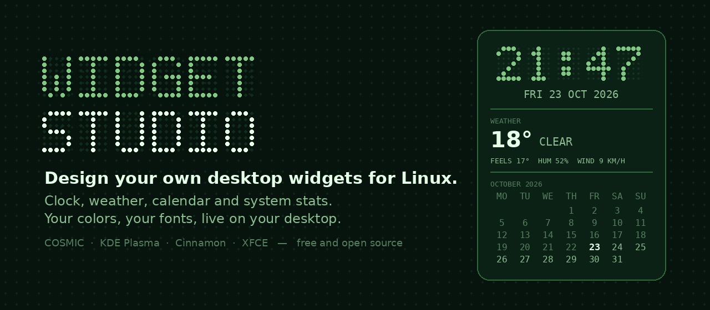

<div align="center">


# Widget Studio

**Design your own desktop widgets for Linux, no config files needed.**

A clock, the weather, this month's calendar and your system stats, styled exactly how you want
them and pinned to your desktop.

[](https://github.com/cyb3rl00m/widget-studio/actions/workflows/tests.yml)
[](https://github.com/cyb3rl00m/widget-studio/releases/latest)
[](LICENSE)


[**Download**](https://github.com/cyb3rl00m/widget-studio/releases/latest) ·
[Install](#install) ·
[Features](#features) ·
[FAQ](#faq)



</div>

## Screenshots

<p align="center">
  
  &nbsp;
  
</p>

## Why Widget Studio?

Desktop widgets on Linux have always meant one of two things: your desktop doesn't have them,
or you hand-edit a Conky config full of `${voffset}` and `${execpi}` until something looks
right, then hope it survives the next reboot.

Widget Studio gives you the good part of Conky without the config files. Pick what goes on
your widget, choose a theme or your own colors and fonts, and adjust the position until it sits
where you want it. **The widget on your desktop updates live while you edit.** No restarting,
no guessing.

## Features

**Sections**

- 🕐 **Clock and date**: 24 or 12 hour, optional seconds, any time zone (keep your home time
  on screen while you travel).
- 🌤️ **Weather**: current conditions, feels-like, humidity, wind, and today's high and low.
  Search any city in the world and filter by country (`Sofia, BG`). Powered by
  [Open-Meteo](https://open-meteo.com), with **no account and no API key**.
- 📅 **Calendar**: the whole month, today highlighted, past days dimmed, week starting on
  Monday or Sunday. The grid centers and lines itself up automatically.
- 📊 **System stats**: CPU, memory and disk usage with bars, plus CPU temperature (AMD and
  Intel sensors detected automatically).

**Make it yours**

- 🎨 **Six themes**: Forest, Nothing, Midnight, Amber terminal, Paper and Glass. Or pick every
  color yourself: background, opacity, clock, highlights, text, dimmed text and lines.
- 🔤 **Any font** on your system. One click installs **Doto**, a free dot-matrix font for
  that Nothing Phone look.
- 📐 **Layout**: reorder sections, toggle labels and divider lines, set width and padding.
- 📍 **Placement**: nine screen positions plus pixel-exact offsets.
- 🧩 **As many widgets as you want**, each with its own settings. Duplicate one and tweak it.

**Just works**

- 🚀 **Starts at login** by itself.
- 📦 **Sets itself up**: if your system's Conky can't draw on your desktop (common on
  Wayland), Widget Studio downloads the official Wayland-ready build for you.
- 🛡️ **Runs as your user**: no root, no password, no system files touched.
- 🔄 **Easy updates**: install the new version and running widgets switch over on their own.
- 🪶 **Light**: widgets are drawn by Conky, one of the lightest system monitors there is.
  Weather is downloaded at most every 15 minutes.

## Supported desktops

| Desktop | Works? |
| --- | --- |
| **COSMIC** (Pop!_OS 24.04) | ✅ Yes |
| **KDE Plasma** (Wayland and X11) | ✅ Yes |
| **Cinnamon** (Linux Mint), **XFCE**, **MATE** and other X11 desktops | ✅ Yes |
| Hyprland, Sway and other wlroots compositors | ⚠️ Should work, not tested yet |
| Stock **GNOME on Wayland** (Ubuntu's default) | ❌ No. GNOME doesn't let apps pin windows to the desktop. |

Tried it on a desktop that isn't listed? [Let me know](https://github.com/cyb3rl00m/widget-studio/issues)
how it went.

## Install

### Ubuntu, Pop!_OS, Linux Mint, Debian, elementary OS

1. Download **`widget-studio_1.0.2_all.deb`** from the
   [latest release](https://github.com/cyb3rl00m/widget-studio/releases/latest).
2. Open a terminal in your Downloads folder and run:

   ```bash
   sudo apt install ./widget-studio_1.0.2_all.deb
   ```

Or do both in one go:

```bash
cd /tmp && wget https://github.com/cyb3rl00m/widget-studio/releases/download/v1.0.2/widget-studio_1.0.2_all.deb && sudo apt install ./widget-studio_1.0.2_all.deb
```

Then open **Widget Studio** from your app menu.

> Needs GTK 4 and libadwaita 1.4 or newer: Ubuntu 24.04 / Pop!_OS 24.04 / Linux Mint 22 /
> Debian 13 or newer. `apt` installs them automatically.

### Fedora

```bash
sudo dnf install python3-gobject gtk4 libadwaita git
git clone https://github.com/cyb3rl00m/widget-studio && cd widget-studio
python3 -m widget_studio
```

### Arch Linux, Manjaro, EndeavourOS

```bash
sudo pacman -S python-gobject gtk4 libadwaita git
git clone https://github.com/cyb3rl00m/widget-studio && cd widget-studio
python3 -m widget_studio
```

When you run from source, keep the folder where it is: the login entry points to it.

## Your first widget in one minute

1. **Open Widget Studio.** It creates your first widget and puts it in the top right corner.
2. **Seeing an "Install Conky" bar at the top?** Click it. It downloads the official Conky
   that can draw on your desktop. You only need to do this once.
3. **Pick a theme** under *Colors → Theme*. For the dot-matrix look, choose **Nothing** and
   click **Install** next to *Get the Doto dot-matrix font*.
4. **Set your city** under *Sections → Weather → Location → Change…*.
5. **Move it** under *Position and size*.

That's it. It comes back by itself every time you log in.

## Updating

Download the new `.deb` and install it the same way. Your widgets and settings are kept.
Widgets that are already running switch to the new version within a minute, without you
doing anything.

## Uninstall

1. In Widget Studio, open the main menu (☰) → **Hide all widgets**, and turn off
   **Show widgets when I log in**.
2. Then:

   ```bash
   sudo apt remove widget-studio
   rm -rf ~/.config/widget-studio ~/.cache/widget-studio ~/.local/share/widget-studio
   ```

## FAQ

<details>
<summary><b>Where is the "Nothing" font?</b></summary>

Nothing's own font (Ndot) isn't free to share. Widget Studio uses **Doto** instead: a free,
open-source dot-matrix font that matches the look. Install it with the button under *Fonts*,
then reopen the app to see it in the font picker (search for `Doto`).
</details>

<details>
<summary><b>Why doesn't it work on stock GNOME?</b></summary>

On Wayland, a widget needs the *layer-shell* protocol to sit on the desktop behind your
windows. COSMIC, KDE Plasma, Hyprland and Sway support it. GNOME doesn't, so a widget would
just be a normal floating window. On X11 desktops everything works.
</details>

<details>
<summary><b>Do I need to know Conky?</b></summary>

No. Widget Studio writes the Conky configs for you. If you're curious, they're in
`~/.config/widget-studio/conky/`, but edit your widgets in the app: hand edits get overwritten.
</details>

<details>
<summary><b>The weather says "unavailable".</b></summary>

Widget Studio couldn't reach Open-Meteo, usually because you're offline. It retries every two
minutes and keeps showing the last forecast for up to six hours.
</details>

<details>
<summary><b>Does it slow my PC down?</b></summary>

No. Conky uses a fraction of a percent of CPU. The background updater wakes up every five
seconds to refresh a few small text files, and downloads the weather at most every 15
minutes.
</details>

<details>
<summary><b>What does it send over the internet?</b></summary>

Only the city name you search for and the coordinates of the city you pick, to Open-Meteo.
Conky and Doto are downloaded from GitHub only when you click their install buttons. See
[SECURITY.md](SECURITY.md).
</details>

## How it works

```
Widget Studio (GTK 4 app) ──writes──▶ ~/.config/widget-studio/conky/<widget>.conf
        │                                          │
        │                                          ▼
        └─starts──▶ background updater ──writes──▶ ~/.cache/widget-studio/   ◀──reads── Conky
                    date, calendar, weather,        (small text files)              (draws the
                    temperature every 5 s                                            widget)
```

- Conky only **displays** text files. Nothing slow or fragile runs inside it, so a slow
  network can never freeze your widget.
- Each widget is always exactly **one** Conky process. Restarts are serialized, so you never
  get doubled widgets.
- When a font you use gets installed, the widget restarts by itself to pick it up.

## Building and testing

```bash
python3 -m unittest discover tests   # engine: configs, calendar, weather, processes, updates
python3 tests/ui_smoke.py            # runs every line of the GTK interface code, no display needed
bash packaging/build-deb.sh          # builds dist/widget-studio_<version>_all.deb
```

Bug reports and ideas are welcome in [Issues](https://github.com/cyb3rl00m/widget-studio/issues).

## Credits

- Made by **[cyb3rl00m](https://github.com/cyb3rl00m)**, built together with
  **Claude by Anthropic**, which helped write and test the code.
- Widgets are drawn by **[Conky](https://github.com/brndnmtthws/conky)** (GPL-3.0). It's
  downloaded on request, not bundled.
- Weather data by **[Open-Meteo.com](https://open-meteo.com/)** (CC BY 4.0).
- **[Doto](https://fonts.google.com/specimen/Doto)** font by Óliver Lalan (SIL Open Font
  License). It's downloaded on request, not bundled.

## More apps by cyb3rl00m

- [**Safe Disk Cleaner**](https://github.com/cyb3rl00m/safe-disk-cleaner): see where your disk
  space went, and understand what's safe to delete.
- [**Uninstaller**](https://github.com/cyb3rl00m/uninstaller): completely remove APT, DNF, Snap
  and Flatpak apps.
- [**Crash Inspector**](https://github.com/cyb3rl00m/crash-inspector): every crash and error
  on your system, in one window.

## License

[MIT](LICENSE). Free to use, change and share.
